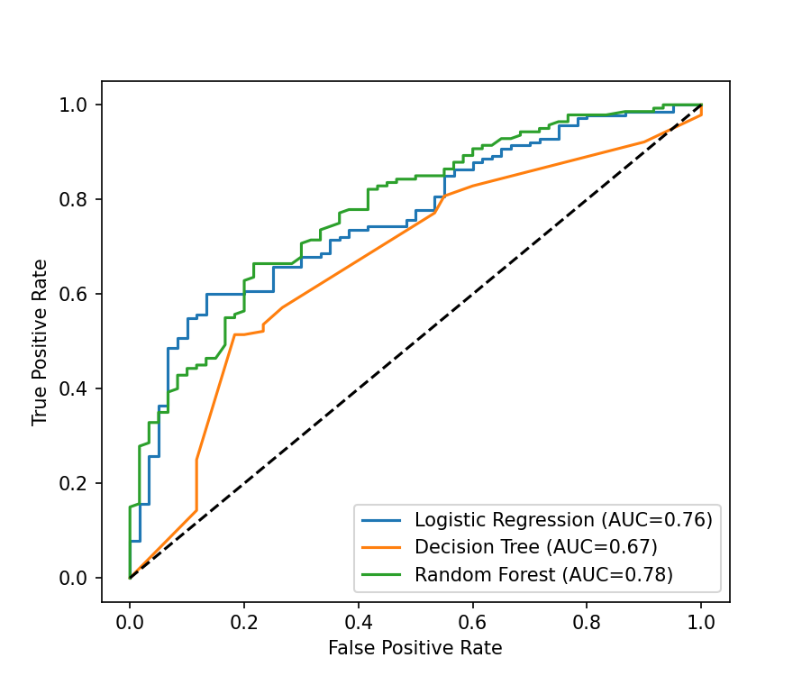

# Credit Scoring Model

Machine Learning internship project (CodeAlpha) that predicts whether a person is a good or bad credit risk using past financial data.

## Problem
Predict an individual's creditworthiness (good / bad) from features like loan amount, duration, age, savings, employment, etc.

## Dataset
German Credit Data (UCI / OpenML `credit-g`): 1000 customers, 20 features. 700 good and 300 bad borrowers.

## Approach
1. Loaded and explored the data
2. Feature engineering: `credit_per_month`, `credit_to_age`, `long_duration`
3. Preprocessing: StandardScaler for numeric, OneHotEncoder for categorical columns
4. 80/20 stratified train-test split
5. Trained 3 models: Logistic Regression, Decision Tree, Random Forest (all with `class_weight="balanced"`)
6. Evaluated with Precision, Recall, F1-Score and ROC-AUC

## Results

Precision, Recall and F1 are weighted averages on the 200-row test set. "Bad-class recall" is the share of actual bad borrowers the model caught.

| Model | Accuracy | Precision | Recall | F1-Score | ROC-AUC | Bad-class Recall |
|-------|----------|-----------|--------|----------|---------|------------------|
| Logistic Regression | 0.675 | 0.728 | 0.675 | 0.688 | 0.761 | 0.70 |
| Decision Tree | 0.625 | 0.713 | 0.625 | 0.640 | 0.675 | 0.73 |
| Random Forest | 0.745 | 0.727 | 0.745 | 0.719 | 0.783 | 0.35 |



## Conclusion
Random Forest gave the best overall ROC-AUC (0.783) and accuracy (0.745). However, it caught only 35% of bad borrowers, while Logistic Regression caught 70% with a ROC-AUC of 0.761. In credit scoring, wrongly approving a bad borrower is costly, so Logistic Regression is the safer choice when missing defaulters matters more than overall accuracy. Next steps: hyperparameter tuning and adjusting the decision threshold for Random Forest.

## How to run
```bash
pip install -r requirements.txt
jupyter notebook credit_scoring.ipynb
```

## Author
Saksham Sharma
